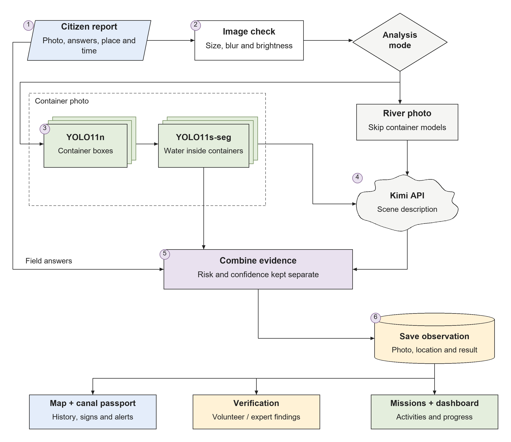
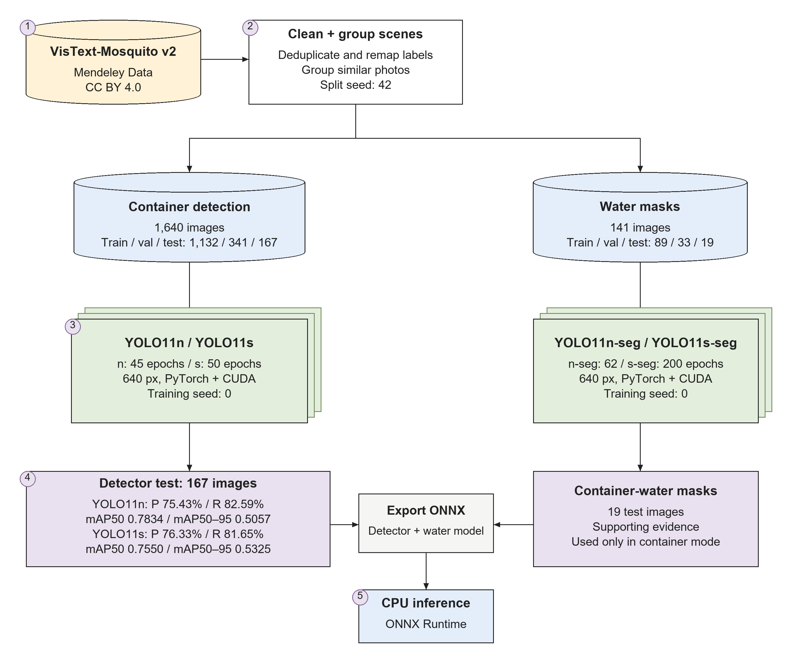
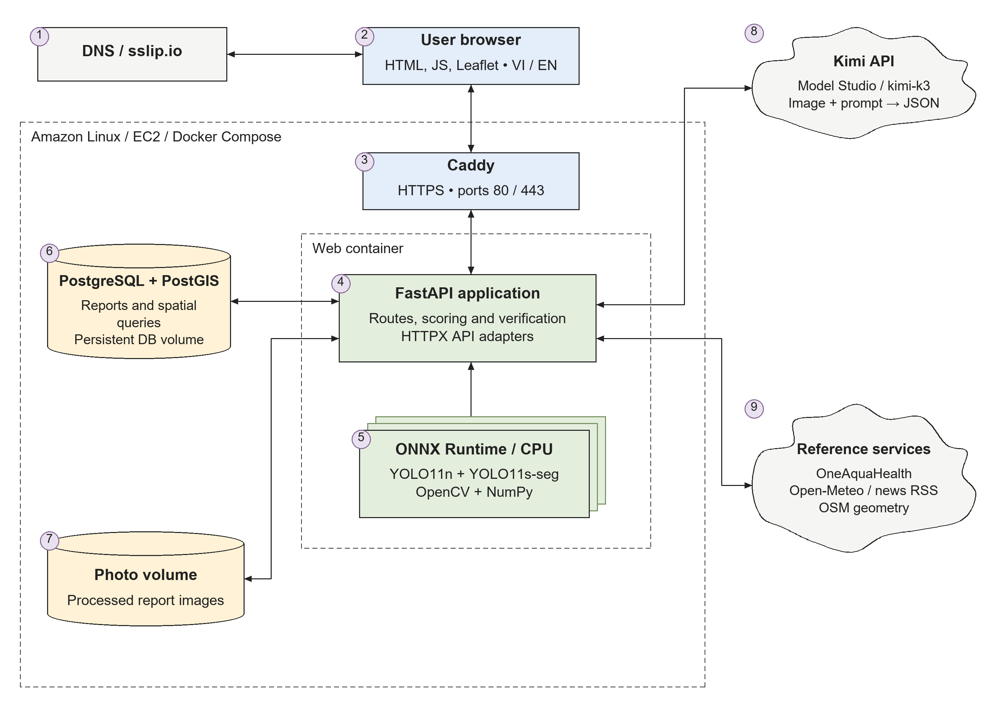
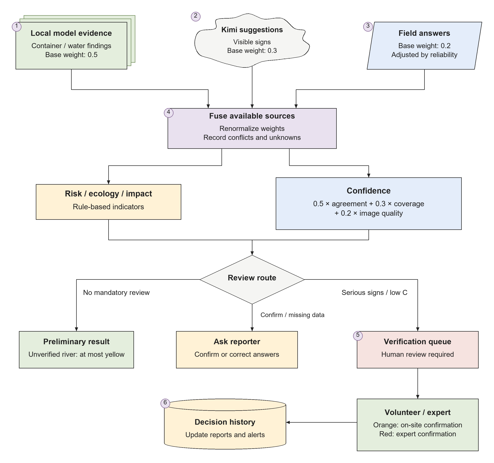

# AquaPulse: Citizen Observations and Human Verification for Urban River Monitoring

Technical research report · Prototype study

AquaPulse project, Vietnam · 4 October 2026

Contact: nkluc2212@gmail.com · Source code: https://github.com/khaluc/AquaPulse

## Abstract

Urban river observations often remain isolated photographs rather than records that can be checked and followed through to action. AquaPulse addresses this problem with a bilingual web application that connects citizen reports, image analysis, spatial records, human verification, and community activities. The prototype combines fine-tuned YOLO11 container detection and water segmentation with external Kimi scene descriptions and structured reporter answers. Evidence is processed according to the scope of each model; confidence is displayed separately from environmental indicators, and serious or uncertain cases require human review. Detection experiments use a cleaned, scene-grouped preparation of VisText-Mosquito. At a validation-selected confidence threshold of 0.35, the clean YOLO11n detector achieves 75.43% precision, 82.59% box recall, and 78.85% F1 on 167 held-out images containing 316 annotated objects. Its test mAP50 is 0.7834 and mAP50–95 is 0.5057. These results support a bounded container-detection task, while segmentation validation results and application demonstrations provide more limited evidence. The report describes the training, evaluation, API integration, deployment, and remaining need for independent local and field validation.

Keywords: citizen observations; urban waterways; object detection; water segmentation; spatial databases; human verification; environmental monitoring.

## 1. Introduction

People who live beside urban rivers and canals regularly notice floating waste, unusual water color, odor, or conditions after rainfall. A photograph can preserve part of an observation, but it does not establish whether the location was inspected, whether another person observed the same condition, or whether any follow-up occurred. The practical problem is therefore both a reporting problem and a coordination problem.

AquaPulse was developed in Vietnam with an initial focus on urban waterways in Ho Chi Minh City. It aims to turn a resident's observation into a structured record that volunteers and experts can examine. The application links the record to a map, a canal section, a review decision, and, when appropriate, a community mission. The implementation and supporting artifacts are available in the project repository [1].

The project distinguishes visible observations from environmental conclusions. Dark water or foam can be recorded as a sign that deserves attention, but a photograph alone does not determine its cause or establish chemical contamination. Similarly, a detected container does not establish the presence of mosquito larvae, infection, or disease transmission. Those distinctions shape the reporting form, model selection, wording, and review permissions.

This report examines three questions. First, what container-detection performance is supported by the prepared dataset and saved experiments? Second, how can trained local models and an external scene-description API be connected without treating every output as a confirmed fact? Third, how can the application preserve the relationship between an observation, the person who verified it, and the follow-up activity?

The contribution is an implemented prototype and an evaluation of its bounded vision task. It includes data preparation, fine-tuning, threshold selection, ONNX inference, spatial reporting, and role-based review. It does not provide a controlled field study of environmental improvement or a validated diagnostic model.

## 2. Study Design and System Scope

The work combines an engineering implementation with offline model evaluation. The detector benchmark evaluates bounding boxes against annotated images. The segmentation logs record training and validation behavior. The application demonstration exercises reporting, maps, verification, and community workflows with explicitly labeled sample records. These forms of evidence answer different questions and are kept separate throughout the report.

The citizen-report workflow begins with a photograph, structured answers, location, and observation time. Field answers supply information that cannot be obtained reliably from an image, such as odor, recent flooding, or the duration of standing water. An image-quality gate checks dimensions, brightness, and sharpness before analysis. The application then records the sources that ran and the evidence available for the selected reporting mode.

Two modes define the inference boundary. Container and standing-water photographs can run the container detector, a water segmenter, and the scene-description service. River-surface photographs omit both local models because those models were trained for containers rather than general river surfaces. River reports instead combine the external description with field answers. Omitting a model is represented as a source that did not assess the scene, rather than a negative finding.

## 3. Dataset Preparation

### 3.1. Source and task definitions

The local vision tasks use VisText-Mosquito version 2, published through Mendeley Data with DOI 10.17632/rtsfh7jh7p.2 and a CC BY 4.0 license [2]. Its source documentation describes container images and water masks collected in Bangladesh, making the geographic difference from the intended Vietnamese deployment an important consideration for later validation.

For AquaPulse, the detection labels are mapped to five application classes: used tire, plastic container, plant pot, coconut shell, and drain inlet. Source water-mask classes are merged into one water class. Segmentation therefore concerns water inside the source containers; it is not a dataset of chemical pollutants or general river-water quality.

### 3.2. Cleaning and scene-grouped splitting

The preparation script removes identified stock-photo previews, collapses brightness-augmented copies, eliminates duplicate images, converts annotations, and preserves source and exclusion manifests. Related scenes, including near-duplicate photographs and short bursts, are grouped before splitting. The purpose is to reduce overlap between nearly identical scenes in training and evaluation.

Split assignment uses seed 42 and approximately 70% training, 20% validation, and 10% testing. The resulting counts are shown in Table 1. Inspection of the current source manifest finds no scene group assigned to more than one split within either task. This is a useful check on the implemented grouping, although it does not establish independence from every possible shared visual background or acquisition condition.

Table 1. Prepared clean datasets. Counts refer to images, not annotated objects.

| Task | Training | Validation | Test | Total |
| --- | ---: | ---: | ---: | ---: |
| Container detection | 1,132 | 341 | 167 | 1,640 |
| Container-water segmentation | 89 | 33 | 19 | 141 |

Cleaning has a cost as well as a benefit. The clean detection test contains only three annotated tire objects. A separate stock-inclusive experiment retains more tire examples, but its different test distribution prevents a direct claim of improvement on the clean benchmark. Both versions are described explicitly rather than merging their best scores into one result.

## 4. Model Training and Evaluation Protocol

### 4.1. Fine-tuning and deployment artifacts

Pretrained Ultralytics YOLO11 checkpoints are fine-tuned for detection and instance segmentation [3]. Training uses PyTorch and CUDA in a Linux Docker environment. Every recorded run uses a 640-pixel image setting and training seed 0. Saved configurations and CSV logs provide the requested epoch limits, completed epochs, and batch sizes summarized in Table 2.

Table 2. Training configurations and completed epochs from the saved experiments.

| Run | Initial model | Limit / completed | Batch |
| --- | --- | ---: | ---: |
| Clean nano detector | YOLO11n | 50 / 45 | 16 |
| Clean small detector | YOLO11s | 50 / 50 | 12 |
| Stock-inclusive small detector | YOLO11s | 50 / 50 | 12 |
| Nano water segmenter | YOLO11n-seg | 100 / 62 | 16 |
| Small water segmenter | YOLO11s-seg | 200 / 200 | 12 |

The default application artifacts are the clean YOLO11n detector and YOLO11s-seg water segmenter exported to ONNX. The exports use static batch-one inputs and run through ONNX Runtime's CPU execution provider [4]. OpenCV and NumPy support preprocessing, box filtering, non-maximum suppression, and mask processing. The model paths remain configurable.

Selecting the nano detector for serving is consistent with keeping CPU inference compact, but this report does not present a measured latency comparison between deployments. Likewise, the selected small water checkpoint should not be interpreted as proven superior to the nano variant on an independent test set.

### 4.2. Threshold selection and held-out detection testing

The detector confidence threshold is selected on validation data before evaluating the test split. The script examines a grid with step size 0.05 and selects the highest threshold that achieves at least 80% overall validation box recall. Matching requires the predicted class to agree with the annotation and intersection-over-union to reach 0.5.

At a fixed threshold, precision is TP / (TP + FP), recall is TP / (TP + FN), and F1 is 2PR / (P + R). These measures describe a particular operating point. The Ultralytics test mAP50 and mAP50–95 summarize average precision across confidence levels and, for mAP50–95, multiple overlap thresholds. They are reported separately from fixed-threshold measures.

The threshold is not reselected to obtain a better test score. Final-epoch training-log metrics are also not substituted for held-out test metrics: the CSV records validation behavior, whereas the detector reports in each run's eval directory contain the test results used here.

## 5. Application Methods

### 5.1. Architecture and spatial records

A FastAPI backend serves a bilingual HTML, CSS, and JavaScript interface. PostgreSQL stores observations, assessments, alerts, verification events, missions, and contribution records. PostGIS supports distance queries, nearby reports, and links between observations and canal sections; its geography distance operations are documented in the project dependencies [5]. Leaflet presents the map and canal passports.

The public prototype is deployed on Amazon Linux AWS EC2 using Docker Compose. Application, database, and Caddy proxy services run separately. Caddy provides HTTPS, and persistent volumes preserve database records and stored photographs. HTTPS also supports browser geolocation when the visitor grants permission. External services remain dependencies rather than being presented as local model capabilities.

The map and passports organize history, observed signs, confidence, alerts, rainfall, and participation for a canal stretch. OpenStreetMap provides canal geometry. Open-Meteo supplies rainfall context when available [6], while published OneAquaHealth records provide separate monitoring references [7]. News records retain their source and publication details. Context records are not silently converted into citizen observations or added to their risk scores.

The application also exports selected structured records using FHIR R4 resources, including Observation, RiskAssessment, and Location [8]. These exports represent interoperability features of the prototype; they do not imply that its indicators have clinical validation or regulatory approval.

### 5.2. External scene descriptions

The configured scene-description service uses kimi-k3 through Alibaba Cloud Model Studio's OpenAI-compatible chat-completions endpoint [9]. HTTPX sends the backend request, with the API key held in server environment configuration. Kimi is an external model; the YOLO experiments are the models fine-tuned for this project.

The request includes a resized, re-encoded image and a prompt in Vietnamese or English. The expected response is structured JSON describing visible signs, certainty, explanations, limitations, and the possible need for human review. Parsing and scope filters keep the output within the application's reporting task. Temporary failures can be retried, and processed-image and language keys allow cached responses to be reused.

A successful description remains a model interpretation. It may miss relevant details or propose a sign that lacks support from another source. When the external service fails, the application records missing analysis rather than inventing a replacement description. The reviewed artifacts do not contain a separate benchmark of Kimi's scene-level accuracy on the intended local population.

### 5.3. Evidence fusion, confidence, and review

Evidence is combined per signal, using only sources capable of contributing to that signal. Base source weights are 0.5 for the detector, 0.3 for the scene model, and 0.2 for the reporter. For stored observations, reporter reliability is derived on the server, with values 0.5 for a new reporter, 0.8 for a trusted reporter, and 1.0 for a volunteer. Analysis previews can accept a supplied reporter level and should be distinguished from the stored-report path. The implemented reporter weight is 0.2r / 0.5, so the base weight corresponds to the new-reporter baseline.

For each signal, the weighted evidence value is obtained by averaging the votes of the available sources according to Equation 1. This is an application scoring rule, not a learned or calibrated probability of contamination. A positive scene-model suggestion without supporting non-scene evidence remains unconfirmed and cannot independently raise the score.

$$p_i = \frac{\sum_{s \in S_i} w_s p_{s,i}}{\sum_{s \in S_i} w_s} \qquad (1)$$

Confidence is computed separately as C = 0.5A + 0.3K + 0.2Q. Agreement A decreases with the spread between contributing votes for relevant positive signals; coverage K measures participation relative to sources expected to run; image-quality Q incorporates quality warnings. When no multi-source positive signal is available, agreement uses a neutral fallback. The coefficient choices are design parameters and have not been fitted to field outcomes.

$$C = 0.5A + 0.3K + 0.2Q \qquad (2)$$

Review routing applies mandatory checks for serious signs, model disagreements, evidence warnings, and low confidence. The current thresholds send cases below 0.60 to verification, while missing information, reporter disagreements, or confidence up to 0.85 can request confirmation. Chemical odor, oil sheen, and dead animals require expert involvement. An unverified river assessment remains at most yellow; on-site volunteer confirmation permits orange, and red requires an expert.

Authorized reviewers can claim tasks, record findings, add notes, and attach before-and-after photographs. Self-verification is prohibited, and review events are stored. Citizens use anonymous browser-generated identifiers, while reviewers sign in with coordinator-issued bearer codes. The current prototype does not use email registration or automatic emailed login codes.

### 5.4. Privacy and information handling

Photographs are re-encoded to remove EXIF metadata. A YuNet face-detector path blurs detected faces before storage or external analysis. Stored report photographs require reviewer access, public map responses omit reporter identifiers, and public coordinates are rounded with precision varying by endpoint.

These measures do not guarantee anonymity. Missing face-detector files or missed detections can leave a face unblurred, and license-plate blurring is not implemented. External scene analysis transmits the processed photograph to the configured provider. A field pilot would require clear participation information, retention policies, and an explicit response to missing privacy components.

## 6. Results

### 6.1. Container-detection performance

For the clean YOLO11n detector, threshold 0.35 achieves validation precision of 74.41%, recall of 80.70%, and F1 of 77.43%. The held-out test contains 167 images with 316 annotated objects. At the selected threshold, the detector produces 261 true positives, 85 false positives, and 55 false negatives. Test precision is 75.43%, box recall is 82.59%, and F1 is 78.85%. The test mAP50 is 0.7834 and mAP50–95 is 0.5057.

Table 3 compares detector runs. Both clean models use the same test split. The stock-inclusive run uses 191 images and 396 objects, with a different class distribution; its row is a separate experiment rather than a same-benchmark improvement.

Table 3. Detector test results. P, R, and F1 are percentages at the validation-selected threshold.

| Detector | Threshold | P | R | F1 | mAP50 | mAP50–95 |
| --- | ---: | ---: | ---: | ---: | ---: | ---: |
| Clean YOLO11n | 0.35 | 75.43 | 82.59 | 78.85 | 0.7834 | 0.5057 |
| Clean YOLO11s | 0.25 | 76.33 | 81.65 | 78.90 | 0.7550 | 0.5325 |
| Stock-inclusive YOLO11s* | 0.45 | 81.33 | 77.02 | 79.12 | 0.8270 | 0.6017 |

*Different test set: 191 images / 396 objects, compared with 167 images / 316 objects for the clean runs.

The clean small detector has slightly higher precision and F1, lower recall and mAP50, and higher mAP50–95 than the clean nano detector. Neither is uniformly better across the reported measures. No repeated-seed analysis or significance test establishes that the small F1 difference represents a stable advantage.

Table 4. Per-class test performance for clean YOLO11n at threshold 0.35. GT is the number of annotated objects.

| Class | GT | TP | FP | FN | Precision | Recall |
| --- | ---: | ---: | ---: | ---: | ---: | ---: |
| Used tire | 3 | 2 | 0 | 1 | 100.00% | 66.67% |
| Plastic container | 56 | 41 | 23 | 15 | 64.06% | 73.21% |
| Plant pot | 105 | 79 | 39 | 26 | 66.95% | 75.24% |
| Coconut shell | 93 | 85 | 12 | 8 | 87.63% | 91.40% |
| Drain inlet | 59 | 54 | 11 | 5 | 83.08% | 91.53% |

The tire result illustrates the difficulty of interpreting an overall score. Two correct detections and no false positives yield observed precision of 100%, but three test objects provide little evidence about reliability. The clean small detector misses all three tires at its selected threshold. Plastic containers and plant pots also show weaker precision and recall than coconut shells and drain inlets.

The stock-inclusive experiment reaches the validation recall target but falls to 77.02% test recall. It includes 80 tire objects, compared with three in the clean split. Its higher mAP therefore cannot establish that retaining stock previews improves performance under the clean evaluation conditions.

### 6.2. Water segmentation

The water dataset is much smaller than the detection dataset. Table 5 reports the final logged validation mask metrics for both segmentation runs. These are neither independent test results nor necessarily the metrics of the validation-selected checkpoint exported for deployment.

Table 5. Final-epoch water-mask validation metrics. Values are tied to the final logged epoch.

| Model | Completed epochs | Precision | Recall | mAP50 | mAP50–95 |
| --- | ---: | ---: | ---: | ---: | ---: |
| YOLO11n-seg | 62 | 61.62% | 44.90% | 0.4764 | 0.3023 |
| YOLO11s-seg | 200 | 63.73% | 30.61% | 0.3603 | 0.2386 |

The small segmenter's final validation recall is modest, and its final mAP values are lower than the nano run's. These rows do not justify a claim that the deployed small model is superior. The reviewed artifacts contain no independent segmentation report for the 19-image test split. In the application, mask absence is consequently not treated as proof that a container is dry, and field answers remain important.

### 6.3. Application demonstration

The implemented workflow includes photo analysis, maps, canal passports, verification tasks, alerts, community missions, contribution points, dashboard summaries, contextual records, and bilingual output. The local demo includes labeled simulated observations and activities so the complete workflow can be inspected without representing those records as real field events.

The screenshot package distinguishes a cached successful Kimi description from a live detector run on a photograph of discarded tires beside the water. That photograph belongs to the training split and produces one tire detection with confidence 0.9613; the segmenter returns no water masks. It demonstrates integration and interface behavior, while the held-out reports supply the detector evaluation evidence.

Automated tests cover scoring, conflicts, quality checks, observations, reviewer permissions, community actions, and localization. These checks support implementation correctness for the exercised cases. They do not establish model generalization, service performance under load, reviewer agreement in practice, or environmental impact.

## 7. Discussion and Limitations

The model results support a constrained application of container detection. Grouping related scenes before splitting reduces an identifiable source of leakage, but it does not resolve the geographic and acquisition differences between the source dataset and everyday reports from Vietnamese waterways. Independent local images, varied devices, nighttime scenes, and different environmental conditions are needed to examine transfer to the intended use.

All reviewed detector test reports contain zero background-only images. The clean nano model's image-level recall of 95.21% describes positive images, not a measured rate of correct rejection for irrelevant photographs. Although false-positive boxes appear in positive images, the benchmark cannot quantify how often the system would flag a completely unrelated scene. Adding negative images is therefore a priority for evaluation.

Class imbalance is another major constraint. Aggregate precision, recall, and average precision can conceal the very small tire test sample. The stock-inclusive variant broadens that class but changes the benchmark and introduces a different source mixture. A future dataset should include legitimate, representative local examples of rare classes rather than using the highest overall score as a substitute for coverage.

Water segmentation requires separate work. Only 141 prepared images are available, and final validation recall is limited. The model's domain is water in containers. Extending it to open river surfaces, wastewater categories, or pollution would require appropriate annotation and independent testing rather than simply changing the interface label.

The evidence and review rules make uncertainty visible, but their weights and confidence formula remain heuristic. No reviewed field study establishes their calibration against contamination measurements or expert judgments. Human review reduces the authority assigned to automated suggestions; it does not eliminate reviewer mistakes, inconsistent judgments, or delays. A pilot should measure agreement, escalation quality, and follow-up completion.

External API descriptions introduce availability, cost, reproducibility, and privacy dependencies. Cached outputs support consistent demonstrations but are not independent trials. The application should continue to distinguish source failure, missing evidence, a model suggestion, and a verified finding. Coordinator-issued reviewer codes are sufficient for the current prototype, while larger participation would require stronger account management and revocation.

Finally, sample verification and cleanup records demonstrate application behavior, not environmental change. A field study should follow real observations from reporting to independent checking and documented action. Contamination and water-safety conclusions would still require appropriate sampling and laboratory assessment; the system's indicators cannot replace those measurements.

## 8. Conclusion and Future Work

AquaPulse connects a bounded computer-vision task to a broader citizen-reporting and human-verification workflow. Its clean nano detector achieves 82.59% box recall and 78.85% F1 on the prepared held-out test split, while the software combines those findings with field answers, external descriptions, spatial context, and documented review. The main practical result is an inspectable path from observation to follow-up, with the evidence source and uncertainty kept visible.

The next stage should collect representative local photographs, expand rare and background classes, complete independent water-segmentation evaluation, and assess the interpretation of confidence with volunteers and experts. A small field pilot can then measure report completeness, reviewer agreement, time to verification, duplicate rates, and completed follow-up. Environmental outcomes should be evaluated using appropriate measurements rather than inferred from simulated activity or model scores.

## 9. Reproducibility and Project Access

The repository [1] includes application code, dataset-preparation and evaluation scripts, deployment files, and the two ONNX serving artifacts. Saved configurations, training CSVs, and detector test reports are the source of the numerical results in this report. Dataset split seed 42 and training seed 0 are recorded, but hardware and library differences can still change rerun outcomes.

The supplementary submission ZIP contains an offline review guide, four diagrams, ten interface screenshots with provenance notes, and selected raw model evidence. The live prototype is https://aquapulse.3.148.215.37.sslip.io/?lang=en. Protected verification actions require a coordinator-issued sign-in code, available by contacting nkluc2212@gmail.com. Local sample-data setup and its separate demo codes are documented in the repository.

## References

[1] AquaPulse project. Source code, model provenance, preparation scripts, and evaluation artifacts. https://github.com/khaluc/AquaPulse

[2] M. F. A. S. Faiyaz. VisText-Mosquito: A Multimodal Dataset for Mosquito Breeding Site Detection, Surface Segmentation, and Reasoning. Mendeley Data, version 2, 28 May 2025. DOI: 10.17632/rtsfh7jh7p.2. https://data.mendeley.com/datasets/rtsfh7jh7p/2

[3] G. Jocher and J. Qiu. Ultralytics YOLO11. Software and official model documentation, 2024. https://docs.ultralytics.com/models/yolo11/

[4] ONNX Runtime contributors. Python inference documentation. https://onnxruntime.ai/docs/get-started/with-python.html

[5] PostGIS project. ST_DWithin reference documentation. https://postgis.net/docs/ST_DWithin.html

[6] Open-Meteo. Weather API documentation. https://open-meteo.com/en/docs

[7] OneAquaHealth. Protecting Urban Aquatic Ecosystems to Promote One Health. Project website. https://www.oneaquahealth.eu/

[8] Health Level Seven International. FHIR Release 4, version 4.0.1. https://hl7.org/fhir/R4/

[9] Alibaba Cloud. Model Studio: OpenAI compatible — Chat. Official API documentation. https://www.alibabacloud.com/help/en/model-studio/qwen-api-via-openai-chat-completions

Online references accessed 4 October 2026. Numerical experiment results are derived from AquaPulse's saved local artifacts rather than from the external documentation.
